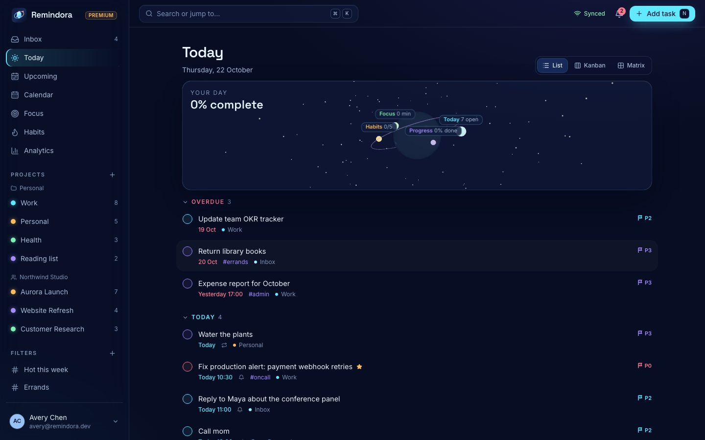
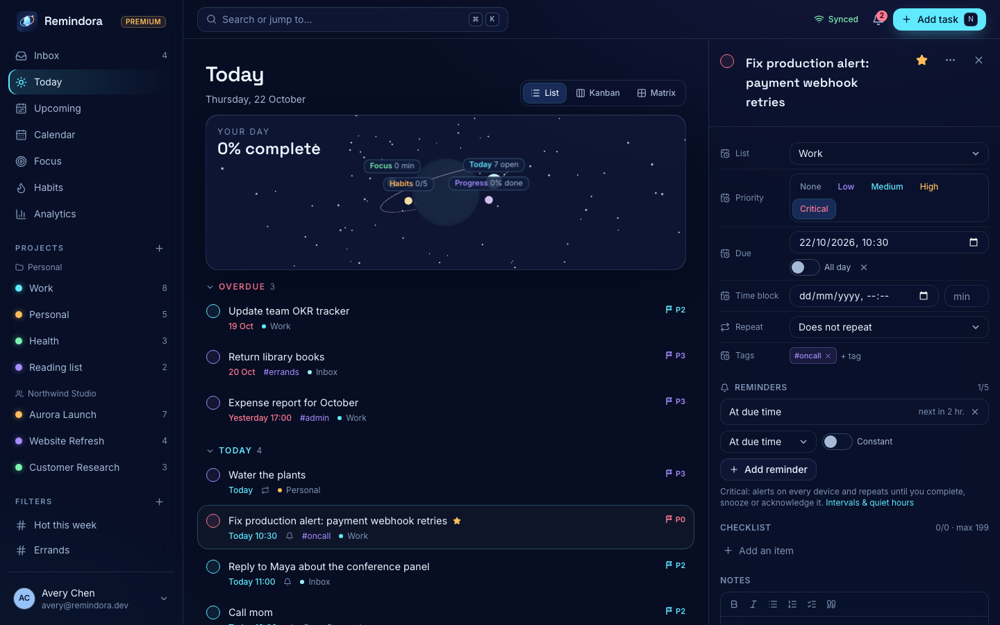
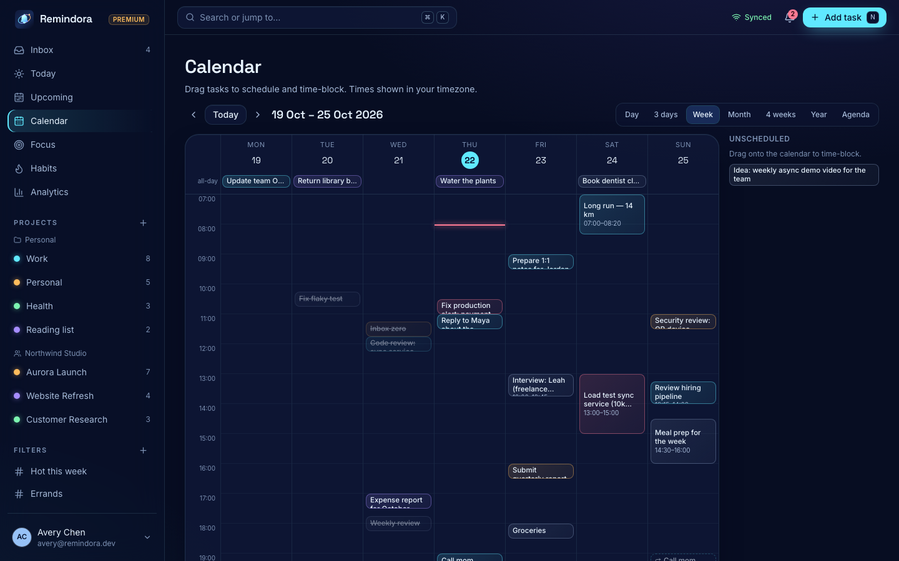
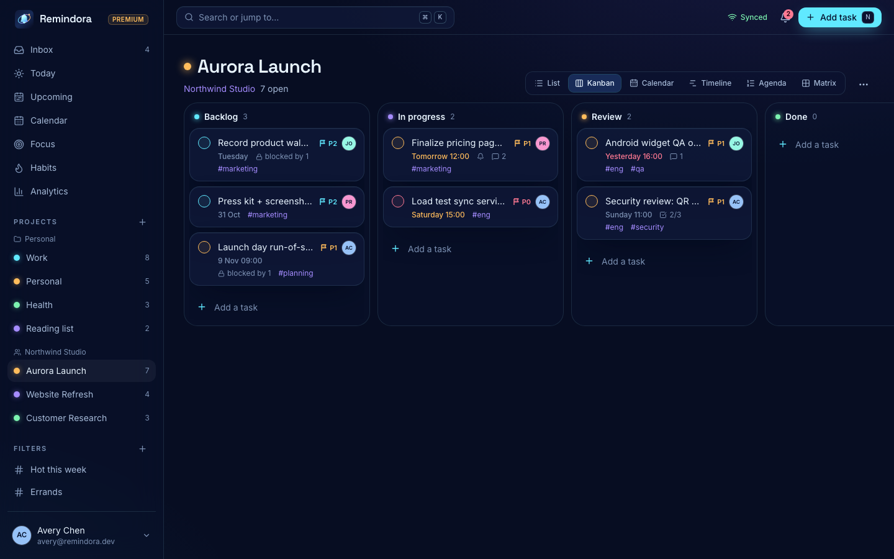
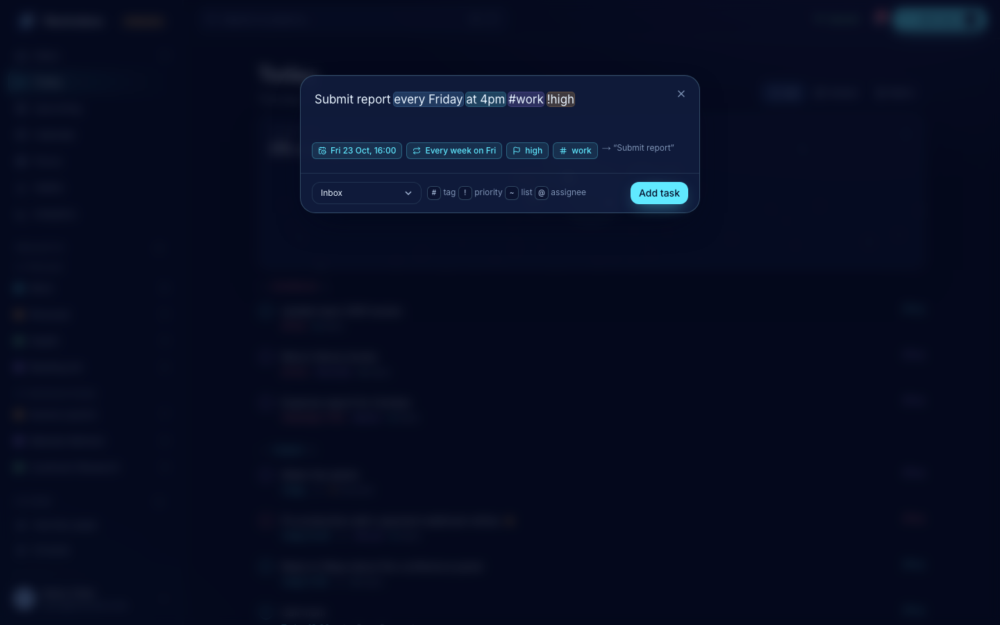
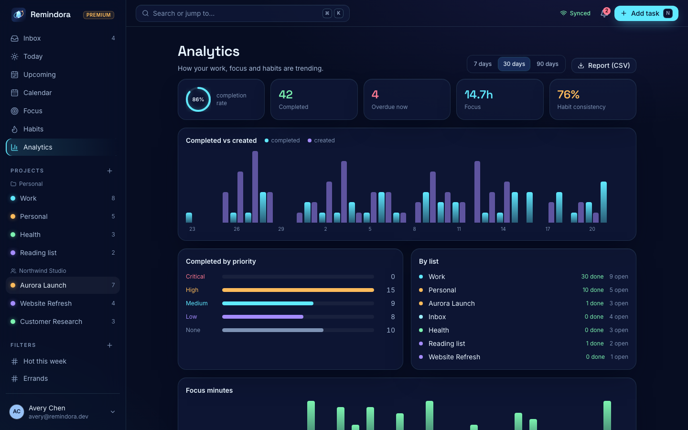
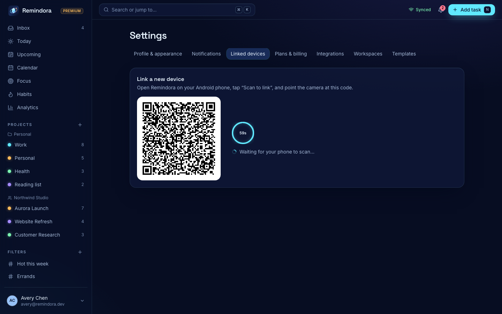

<p align="center"></p>

<h1 align="center">Remindora</h1>
<p align="center">Personal and team task management for Web, Desktop and Android: capture instantly, plan your time, build habits, focus deeply, and get priority-aware reminders on every device.</p>



| | | |
|---|---|---|
|  |  |  |
|  |  |  |

---

## Contents

- [What's in the box](#whats-in-the-box)
- [Repository layout](#repository-layout)
- [Quick start (local)](#quick-start-local)
- [Running each app](#running-each-app)
- [Environment variables](#environment-variables)
- [Testing](#testing)
- [Premium entitlements](#premium-entitlements)
- [Security model and assumptions](#security-model-and-assumptions)
- [Deployment](#deployment)
- [Verification status](#verification-status)
- [Architecture](docs/ARCHITECTURE.md) · [OpenAPI](docs/openapi.json) (live at `/docs`)

## What's in the box

**Tasks**
- Global Quick Add with natural-language parsing: `Submit report every Friday at 4pm #work !high` becomes a weekly task due Fridays at 16:00, tagged *work*, with high priority. Recognised tokens are highlighted live.
- ⌘K command palette and keyboard shortcuts.
- Tasks support rich-text notes, checklists, priority, tags, lists and sections, assignee, start/due/duration, attachments, comments with @mentions, reminders, recurrence (from the due date or from completion), dependencies, and full history.
- Smart lists: Inbox, Today, Upcoming, Overdue, Assigned to me, Completed, Favorites, Archive, Trash.
- Views: List, Kanban (drag with depth and magnetic drop zones), Calendar, Timeline/Gantt, Agenda, Eisenhower Matrix.
- Drag-and-drop ordering and scheduling, advanced search, saved smart filters, templates, and bulk actions.

**Calendar**
- Day, 3-day, week, month, 4-week, year and agenda views.
- Time blocking with start time and duration.
- Repeating tasks projected as ghost occurrences.
- ICS subscriptions plus Google/Outlook import.
- All dates are stored in UTC and rendered in your timezone. Recurrence is DST-safe.

**Focus, habits and countdowns**
- Pomodoro timer with configurable cycles, linked tasks, session history, and generated ambient sound.
- Habits on daily or weekly schedules, with streaks, a heatmap and charts.
- Countdowns to important dates.

**Analytics**
- Completion rate, overdue count, focus time, habit consistency, distribution and trends.
- Premium adds insights and CSV reports.

**Collaboration**
- Shared workspaces with owner, admin, member and viewer roles.
- Invites, assignment, comments and mentions, a notification center, and real-time updates.
- Role-based authorization on every workspace endpoint, with a security audit log.

**Priority notification engine**
- Critical, High, Medium and Low priorities, each with its own channels and user-configurable repeat intervals (defaults: 30 min for Critical, 2 h for High).
- Maximum re-alert count, quiet hours, weekend handling, timezone awareness, and per-project overrides.
- One-tap Snooze, Complete, Reschedule and Stop reminders.
- Acknowledging an alert on one device dismisses it on every other device instantly.
- Morning priority digest and an evening planning reminder.
- A full delivery event log.

**Device linking**
- Email code or magic link, and OAuth.
- Approval from an already signed-in device for sensitive sign-ins.
- Single-use, encrypted QR pairing tokens valid for 60 seconds, with confirmation on both devices and biometric verification on the phone.
- A Linked Devices center with remote revocation.

**Plans**
- Free, Premium and Team. Limits and features are authorized on the server and stored in the database, so they can change without an app update.

**Platforms**
- **Web**: a responsive Next.js app.
- **Desktop**: Tauri, using the same UI, with OS-keychain sessions, a tray, a global Quick Add shortcut, deep links and a signed auto-updater.
- **Android**: React Native and Expo, with FCM push, priority notification channels, action buttons, QR scanning, a biometric app lock, a home-screen widget and deep links.

The design language is a "midnight glass observatory": navy glass surfaces with cyan, violet and amber light. An optional React Three Fiber orbit visualises your day. Every motion effect falls back to simple fades under *reduce motion*. The UI is audited against WCAG 2.1 AA.

## Repository layout

```
apps/
  api/        NestJS REST API + Socket.IO realtime gateway (OpenAPI at /docs)
  workers/    BullMQ workers: reminders, push/web-push/email delivery, digests, habits, integrations, maintenance
  web/        Next.js 15 web app (also exported statically for the desktop shell)
  desktop/    Tauri v2 shell (Rust): keychain, tray, global shortcut, deep links, updater
  mobile/     Expo SDK 58 / React Native 0.88 Android app + home-screen widget
packages/
  types/          Shared domain types, zod schemas, realtime contract
  core/           NLP Quick Add, recurrence, timezones, ICS, habit streaks, offline merge
  auth/           Crypto, access tokens, QR pairing tokens, sessions, RBAC
  notifications/  Priority policy engine, Android channels, queue contract, email
  entitlements/   Plan catalog + DB/flag-driven resolution
  database/       Prisma schema, migrations, seed
  ui/             Design tokens + React design system
  config/         Validated environment, shared ESLint base
docs/            Architecture, OpenAPI spec, screenshots
```

## Quick start (local)

Requirements: **Node 24** (`.nvmrc`) and npm 11. Docker is optional.

```bash
npm ci
cp .env.example .env
# Fill the four required secrets (32 random bytes each):
for k in JWT_SECRET ENCRYPTION_KEY PAIRING_KEY OTP_PEPPER; do
  sed -i '' "s|^$k=$|$k=$(openssl rand -base64 32)|" .env   # Linux: sed -i "s|...|...|"
done

# Postgres + Redis — either embedded (no Docker; leave running in its own terminal):
npm run local:infra
# …or with Docker:  docker compose up -d   (same ports: Postgres 54329, Redis 63799)

npm run build:packages
npm run db:migrate
npm run db:seed        # realistic demo data (wipes the dev database)
npm run dev            # API :4000 · workers · web :3000
```

Open <http://localhost:3000> and sign in as **avery@remindora.dev** (Premium, owner of a shared workspace) or **jordan@remindora.dev** (Free). With `EMAIL_PROVIDER=console`, the 6-digit code is printed in the API terminal. API docs are at <http://localhost:4000/docs>.

To make someone an admin, so they can change plan limits and flags at runtime, run `UPDATE "User" SET "isAdmin" = true WHERE email = '…';`.

## Running each app

### Web
`npm run dev -w @remindora/web` for development, and `npm run build -w @remindora/web && npm run start -w @remindora/web` for production. Set `NEXT_PUBLIC_API_URL` at build time. To enable browser push even when the tab is closed, set `VAPID_PUBLIC_KEY` and `VAPID_PRIVATE_KEY` on the API and `NEXT_PUBLIC_VAPID_PUBLIC_KEY` on the web (`npx web-push generate-vapid-keys`).

### Desktop (Tauri)
Install Rust ([rustup](https://rustup.rs)) plus the platform prerequisites for [Tauri](https://tauri.app/start/prerequisites/).

```bash
npm run dev -w @remindora/web            # terminal 1 (UI on :3000)
npm run dev -w @remindora/desktop        # terminal 2 (native shell loading :3000)

# Release build: static-exports the web UI, then bundles .app/.dmg (macOS), .msi/.exe (Windows), .deb/.AppImage (Linux)
export TAURI_SIGNING_PRIVATE_KEY="$(cat ~/.remindora/updater.key)" TAURI_SIGNING_PRIVATE_KEY_PASSWORD=""
NEXT_PUBLIC_API_URL=https://api.your-domain npm run build -w @remindora/desktop
```

- Global Quick Add is ⌥⌘Space on macOS and Alt+Ctrl+Space elsewhere.
- Closing the window keeps the app in the tray, so reminders keep arriving.
- The refresh token is stored in the macOS Keychain, Windows Credential Manager or Secret Service.
- Before shipping, update `connect-src` in `src-tauri/tauri.conf.json` and the updater `endpoints` to your domains.

### Android (Expo)

```bash
cd apps/mobile
EXPO_PUBLIC_API_URL=http://10.0.2.2:4000 npx expo run:android   # emulator; use your LAN IP on a real phone
# or a cloud build:  npx eas build --platform android --profile preview
```

- **Push.** Add your Firebase `google-services.json` to `apps/mobile/` (or set `GOOGLE_SERVICES_JSON` on EAS) and set the `FCM_*` variables on the API. Without FCM, the app registers through the Expo push service, which needs `EAS_PROJECT_ID`.
- **Notification channels.** Critical, High, Default and Quiet. Only Critical requests Do Not Disturb bypass, and only after the user grants notification-policy access from the in-app settings. The settings screen also links to Android's battery-optimisation exemption, because some OEMs delay reminders.
- **Widget.** Long-press the home screen, open *Widgets*, choose *Remindora · Today*.
- **Linking.** On a signed-in desktop or web app, go to *Settings → Linked devices → Link a new device*. On the phone, tap *Scan QR from my computer*.

## Environment variables

Everything is validated at boot (`packages/config/src/env.ts`); a missing or invalid value fails fast with a readable error. See [`.env.example`](.env.example).

| Variable | Required | Purpose |
|---|---|---|
| `DATABASE_URL`, `REDIS_URL` | ✅ | Postgres 15+ and Redis 6.2+ (BullMQ needs `maxmemory-policy noeviction`) |
| `JWT_SECRET`, `ENCRYPTION_KEY`, `PAIRING_KEY`, `OTP_PEPPER` | ✅ | 32-byte keys (base64 or hex). **Keep `ENCRYPTION_KEY` stable**: it encrypts OAuth, push and integration tokens at rest |
| `API_PUBLIC_URL`, `WEB_URL`, `CORS_ORIGINS` | ✅ | Public URLs; CORS allow-list (include `tauri://localhost,http://tauri.localhost` for desktop) |
| `COOKIE_SECURE`, `COOKIE_DOMAIN` | prod | Secure, httpOnly refresh cookie for the web (e.g. `.remindora.app`) |
| `EMAIL_PROVIDER` + `SMTP_URL` / `RESEND_API_KEY`, `EMAIL_FROM` | prod | Sign-in codes, invites, email reminders, digests |
| `GOOGLE_*`, `GITHUB_*`, `MICROSOFT_*` | optional | OAuth sign-in (buttons hide when unset); Google/Microsoft also power calendar import |
| `NOTION_*`, `SLACK_*` | optional | Integration OAuth (Slack incoming webhooks and Zapier need no keys) |
| `FCM_PROJECT_ID`, `FCM_CLIENT_EMAIL`, `FCM_PRIVATE_KEY` | Android push | Firebase service account (HTTP v1) |
| `VAPID_PUBLIC_KEY`, `VAPID_PRIVATE_KEY`, `VAPID_SUBJECT` | web push | Browser push |
| `S3_*`, `MAX_ATTACHMENT_BYTES` | optional | S3/R2/MinIO attachments; without them, attachments are stored on local disk using signed URLs (dev) |
| `BILLING_PROVIDER` (`dev`/`stripe`), `STRIPE_*` | prod | Checkout, customer portal, signed webhooks at `/billing/webhook/stripe` |
| `AI_PROVIDER` (`heuristic`/`anthropic`), `ANTHROPIC_API_KEY`, `AI_MODEL` | optional | AI planning features (Premium). Defaults to the deterministic local planner |
| `SENTRY_DSN`, `LOG_LEVEL` | optional | Error tracking and structured logs |
| `DEV_TOOLS` | dev only | Instant plan switching; **refused in production** |
| `RATE_LIMIT_MULTIPLIER` | tests only | Must be `1` in production (enforced) |

## Testing

| Suite | Command | Count | Covers |
|---|---|---|---|
| Unit | `npx turbo run test --filter='./packages/*'` | 74 | Recurrence (DST, COUNT/UNTIL, from-completion), NLP parsing, priority notification rules, entitlements, QR-token expiry/single-use/tamper, device revocation and sessions, RBAC, crypto, ICS, habits, offline merge |
| API e2e | `npm run test:e2e -w @remindora/api` | 31 | Real Postgres + Redis (started automatically): email/magic-link sign-in, approval, refresh-token reuse detection, CSRF, device revocation, the QR linking flow, task creation, recurrence rollover, conflicts, RBAC, plan limits, calendar scheduling, critical alerts with acknowledgement across devices, snooze and sweeper recovery, cross-device sync, invites |
| Browser e2e | `npx playwright test` in `apps/web` | 7 | Real API + workers + production web build: Quick Add, device approval with realtime sync, drag-to-calendar scheduling, cross-device reminder acknowledgement, WCAG 2.1 AA audit (axe) in dark theme, light theme and at mobile width |

The browser suite expects Postgres and Redis to be running (`npm run local:infra`). It uses its own `remindora_e2e` database and ports 3100/4100. CI (`.github/workflows/ci.yml`) runs all of the above, plus the Android JavaScript bundle and a desktop `cargo check`.

## Premium entitlements

- Plan defaults (Free: 9 lists, 99 tasks per list, 2 reminders per task, …; Premium: 299 lists, …) are seeded into the `Entitlement` table.
- The server resolves entitlements in this order: plan rows, then per-user overrides, then `FeatureFlag` kill switches and staged rollouts.
- Every limit and feature is enforced in the API. A blocked request returns `402` with `code: plan_limit | plan_feature`; clients only display the result.
- Admins change limits live with `PUT /admin/entitlements` and `PUT /admin/flags/:key`. No app release is needed.
- Billing is behind a `BillingProvider` interface. Stripe is implemented with signature-verified, idempotent webhooks. The `dev` provider activates plans instantly for local testing.

## Security model and assumptions

- **Sessions.** Each device gets its own session. A short-lived HS256 access token (15 min) is paired with an opaque refresh token; only its SHA-256 is stored. Refresh tokens rotate on every use, and replaying an old token revokes the session.
  - Every request re-checks the session and device, so revocation is immediate.
  - Web stores the refresh token in an httpOnly, SameSite=Lax cookie scoped to `/auth`. CSRF protection is a required custom header plus an Origin allow-list.
  - Desktop uses the OS keychain. Android uses SecureStore (Keystore). Access tokens live only in memory.
- **Email codes.** 6 digits, compared via HMAC with a server pepper. Single use, 10-minute expiry, 5 attempts, and rate-limited per email and per IP. Responses never reveal whether an account exists. Magic links are redeemed only by the requesting device (poll secret).
- **QR pairing.** The token is `AES-256-GCM({pairingId, secret, exp})`. It contains no user data, password or session token, expires in 60 seconds, and only `sha256(secret)` is stored.
  - Claiming is an atomic compare-and-set, so a token works exactly once.
  - Creating a token requires re-authentication within the last 5 minutes. The phone requires biometric confirmation, and both screens show the same 4-digit code before the initiating device approves.
  - Tokens are never logged: request bodies and query strings are redacted, and URLs are logged without query strings.
- **Encryption at rest.** OAuth tokens, push tokens, integration credentials and biometric re-auth secrets are encrypted with AES-256-GCM, bound to their row id. Passwords don't exist; sign-in is passwordless.
- **Authorization.** Every workspace endpoint asserts a role permission. Non-members get 404, so the existence of a resource doesn't leak. Denials, role changes, device events, admin changes and billing events are written to `AuditLog`.
- **Input handling.** All input is validated with zod. Rich text is sanitized server-side (allow-list). User-supplied URLs (ICS feeds, webhooks) go through an SSRF guard that requires http(s), blocks private, loopback and link-local addresses, re-validates each redirect, and caps size and time.
- **Uploads.** Attachments are size- and type-checked and served through short-lived signed URLs.
- **Rate limits.** Redis-backed limits, global and per route (auth, pairing, AI).
- **Headers.** Helmet on the API. CSP, HSTS and nosniff on the web. A strict CSP and least-privilege capabilities on the desktop.
- **Assumptions.** Production runs behind TLS (`COOKIE_SECURE=true`). `ENCRYPTION_KEY` lives in a secret manager and is backed up. Redis isn't publicly reachable. Account recovery when every device is lost relies on email access, and the approval requirement only applies when another device was active in the last 14 days.
- **Known dependency advisories** (`npm audit --omit=dev`): `postcss` (inside Next's build pipeline) and `deepmerge-ts` (inside the Prisma CLI). Both run at build or CLI time on trusted input, not on request paths. The fixes require Next 16 and Prisma 7 major upgrades. Runtime advisories in NestJS, nodemailer, sanitize-html, the AWS SDK, Sentry and Vitest were patched.

## Deployment

**Render** (`render.yaml` blueprint) creates Postgres, Redis (Key Value, `noeviction`), the API (with `prisma migrate deploy` as a pre-deploy step), the workers and the web app. Fill in the `sync: false` secrets in the dashboard.

**Docker** (any platform):

```bash
docker build --target api     -t remindora-api .
docker build --target workers -t remindora-workers .
docker build --target web     -t remindora-web --build-arg NEXT_PUBLIC_API_URL=https://api.example.com .
# Run migrations once per release:
docker run --rm --env-file .env remindora-api sh -c "cd /app/packages/database && npx prisma migrate deploy"
```

Scale the API horizontally; Socket.IO fans out through the Redis adapter. Workers can also run several replicas, because jobs are deduplicated and reminders are claimed per row. Point Prometheus at `/metrics` and use `/health` for liveness and readiness checks.

**Desktop releases.** Sign the updater artifacts with your Tauri key, host `latest.json` and the bundles at the updater endpoint, and notarize the macOS build with a Developer ID. A local updater key pair was generated at `~/.remindora/updater.key` (private, never commit it) and `.pub`; its public key is already in `tauri.conf.json`. Move the private key into your CI secret store before your first public release.

**Android releases.** `eas build --platform android --profile production` produces an `.aab`, and `eas submit` uploads it to Play Console.

## Verification status

What was run and verified while building this:

- ✅ All 74 unit tests, 31 API end-to-end tests and 7 browser end-to-end and accessibility tests pass against real Postgres 17 and Redis.
- ✅ The web production build and the static desktop export build cleanly. Every screen was exercised in Chromium at desktop and phone widths.
- ✅ The desktop app compiled to a signed `.app`, a `.dmg` and a signed updater artifact (macOS x64). It launched, loaded the bundled UI and reached the API.
- ✅ The Android JavaScript compiles to a Hermes bundle through Metro (`expo export`), and the project typechecks.

What needs your credentials or devices, and hasn't been exercised end to end:

- ⚠️ **Android on a device.** No APK was built here (no Android SDK on this machine). Test push delivery (FCM), action buttons, the widget, biometrics and camera scanning on a real phone after `eas build`.
- ⚠️ **Third-party services.** FCM, Web Push (VAPID), Stripe checkout and webhooks, OAuth providers, Google/Outlook/Notion import and export, S3, Resend/SMTP and the Anthropic provider are implemented against their documented APIs but need real credentials to verify.
- ⚠️ **Windows and Linux desktop bundles** come from the same config and code but were only built for macOS here. CI runs `cargo check` on macOS.
- ⚠️ **Docker images** weren't built locally (no Docker). The Next standalone output they depend on was verified.
