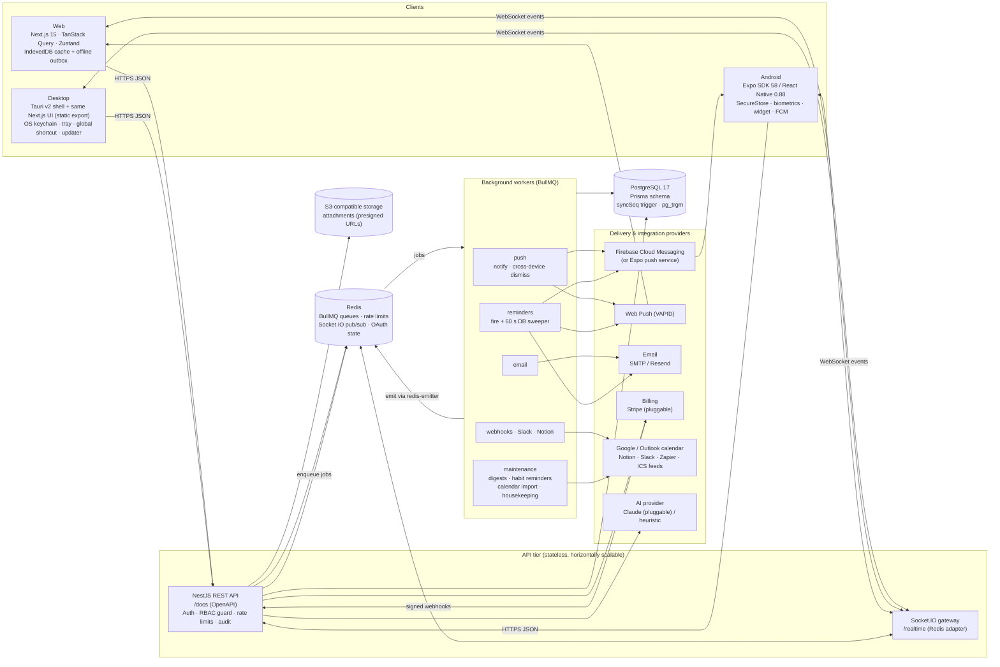
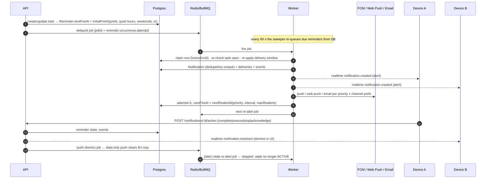
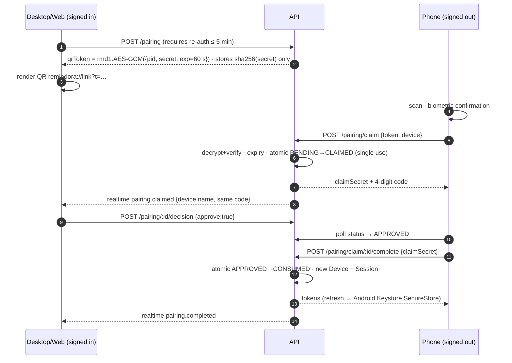

# Remindora architecture

## System overview

**Source of truth.** PostgreSQL holds every durable fact, including the next fire time of each reminder (`Reminder.nextFireAt`). Redis holds delayed jobs, rate-limit counters, Socket.IO pub/sub and short-lived OAuth/biometric state. If Redis is wiped, the worker's 60-second sweeper re-queues every due reminder from Postgres.

## Packages

| Package | Responsibility |
|---|---|
| `@remindora/types` | Domain enums, zod input schemas (shared server validation + OpenAPI), DTOs, realtime event contract |
| `@remindora/core` | Quick-Add NLP parser, timezone helpers, DST-safe recurrence (rrule), ICS parser, habit streaks, field-level merge + outbox coalescing |
| `@remindora/auth` | AES-256-GCM secret envelopes, HS256 access tokens, OTP codes, QR pairing tokens, session validity rules, RBAC matrix |
| `@remindora/notifications` | Priority policy engine, Android channel mapping, queue contract, email sender + templates, SSRF-safe fetch |
| `@remindora/entitlements` | Plan catalog (seed defaults), DB/flag-driven resolution, limit checks |
| `@remindora/database` | Prisma schema, migrations, seed, ICS subscription sync |
| `@remindora/ui` | Design tokens and React design system (Tailwind v4 + Radix) |
| `@remindora/config` | Validated server environment, shared ESLint base |

## Request lifecycle

1. **Authentication**: `AuthGuard` verifies the bearer HS256 token, then loads the session and device and rejects revoked, expired or idle ones. Revocation therefore takes effect on the next request, not at token expiry.
2. **Rate limiting**: `RateLimitGuard` keeps fixed-window counters in Redis, shared across instances, and applies stricter per-route rules to auth and pairing.
3. **Validation**: every body and query goes through a zod schema (`ZodPipe`). The same schema generates the OpenAPI request body.
4. **Authorization**: services call `AccessService.workspace/project/task(user, id, permission)`. A user who isn't a member gets 404, a member lacking the permission gets 403, and every denial is written to the audit log.
5. **Entitlements**: `EntitlementsService` resolves code defaults, then plan rows, then per-user rows, then feature-flag gates. Values are cached for 30 s, and limits are enforced server-side (402 `plan_limit` / `plan_feature`).
6. **Side effects**: the activity log (user-visible history), the audit log (security trail), realtime fan-out to workspace/user/session rooms, BullMQ jobs, and webhooks.

## Priority notification engine

| Priority | Channels | Repeats |
|---|---|---|
| Critical | in-app + push + desktop + web push (+ email if opted in and entitled) | every `criticalRepeatMinutes` (default 30) until complete/snooze/acknowledge, max `maxRealerts` |
| High | in-app + push + desktop + web push | every `highRepeatMinutes` (default 120) until acknowledged |
| Medium | in-app + push + desktop + web push | once, plus optional single follow-up |
| Low / None | silent notification-center item, or morning digest only | never |

Safeguards:

- **Quiet hours.** Alerts that land inside quiet hours move to the end of the window. Critical alerts break through only if the user opts in.
- **Weekends.** If weekend alerts are off, they move to Monday morning.
- **Per-project overrides.** A project can be muted, or given its own channels and intervals.
- **Constant reminders** (a Premium feature) make a low-priority task repeat like a high-priority one.
- **Exactly-once delivery** for each occurrence and attempt comes from three mechanisms: the BullMQ `jobId`, a row-level claim, and a unique `Notification.dedupeKey`.
- **Lifecycle log.** Every `SCHEDULED`, `DELIVERED`, `OPENED`, `SNOOZED`, `FAILED`, `ACKNOWLEDGED`, `COMPLETED`, `STOPPED` and `SUPPRESSED` event is written to `NotificationEvent`. `/metrics` exposes the last 24 hours to Prometheus.

## Device linking

Email linking uses a 6-digit code plus a magic link. Both are single-use, expire after 10 minutes, are limited to 5 attempts, and are rate-limited per email and per IP. The device that asked for the code holds a `pollSecret`, so a magic link opened on another device can verify the request but only the asking device receives the session.

When the user's setting is on and another device was active in the last 14 days, a new sign-in waits for approval from a signed-in device (`device.approval_requested` plus a push). Refresh tokens rotate, and reuse of a rotated token revokes the session. Native devices can enrol a biometric-gated secret: `HMAC(secret, nonce)` proves biometric unlock for re-authentication.

## Offline-first sync

- **Cache.** Clients persist their query cache (IndexedDB on web/desktop, AsyncStorage on Android), so the app opens instantly even without a network.
- **Outbox.** Mutations made offline are queued with a `clientId` (idempotent creates) or a `baseVersion` (edits). Consecutive edits to the same entity are coalesced, and the queue replays when the connection returns.
- **Field-level merge.** Each task carries `version` and `fieldVersions`. An edit made against `baseVersion` conflicts only on fields that someone else changed after that version; other fields merge. A conflict returns `409 edit_conflict` along with the server copy. The web UI offers *keep mine* or *keep theirs*; on Android the server copy wins.
- **Catch-up feed.** A Postgres trigger stamps every task and project write with a global `syncSeq`. `GET /sync/changes?cursor=` returns everything after the cursor, including soft-deleted tombstones.
- **Realtime.** `task.upserted` and `task.deleted` events go to workspace rooms with `originSessionId`, so the device that made a change ignores its own echo.

## Data model

All timestamps are `timestamptz` (UTC); the UI renders them in the user's IANA timezone. User content is soft-deleted, and items in Trash are purged after 30 days. The models are:

`User`, `Account`, `Session`, `Device`, `EmailChallenge`, `DevicePairingToken`, `Workspace`, `Membership`, `Invite`, `Folder`, `Project`, `Section`, `Task`, `Subtask`, `Tag`, `TaskTag`, `TaskDependency`, `Favorite`, `RecurrenceRule`, `Reminder`, `Attachment`, `Comment`, `ActivityEvent`, `AuditLog`, `Habit`, `HabitCheckIn`, `FocusSession`, `Countdown`, `SavedFilter`, `Template`, `Notification`, `NotificationDelivery`, `NotificationEvent`, `NotificationPreference`, `ProjectNotificationOverride`, `Subscription`, `Entitlement`, `FeatureFlag`, `BillingEvent`, `Integration`, `CalendarSubscription`, `ExternalEvent`.

See `packages/database/prisma/schema.prisma`.
